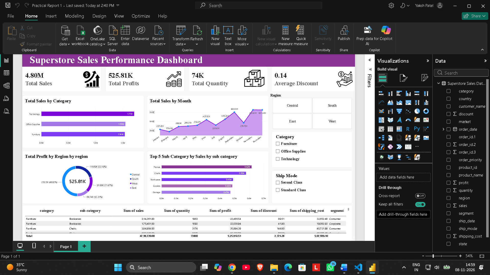

<div align="center">

# 🛒 Superstore Sales Analytics Dashboard

### An interactive Power BI report that turns 51,000+ global retail transactions into clear, actionable business insights.


**[🎥 Watch the Video Walkthrough](#-video-walkthrough)** · **[📊 View Insights](docs/INSIGHTS.md)** · **[📚 Data Dictionary](docs/DATA_DICTIONARY.md)**

⭐ *If you find this project useful, please give it a star. It really helps!*

</div>

---

## 📌 Table of Contents
- [Project Overview](#-project-overview)
- [Dashboard Preview](#️-dashboard-preview)
- [Video Walkthrough](#-video-walkthrough)
- [Business Questions Answered](#-business-questions-answered)
- [Key Insights](#-key-insights)
- [Dataset](#-dataset)
- [Dashboard Features](#-dashboard-features)
- [Tools & Skills](#️-tools--skills)
- [Repository Structure](#️-repository-structure)
- [How to Run](#-how-to-run)
- [Recommendations](#-recommendations)
- [Author](#-author)

---

## 🎯 Project Overview

Superstore is a global retailer selling **Furniture, Office Supplies and Technology** across **7 markets, 147 countries and 3 customer segments**.

This project builds a one-page, interactive **Power BI dashboard** that lets decision-makers track sales, profit, quantity sold and discounting at a glance, and drill down by **region, category and shipping mode** to find what drives (or hurts) performance.

## 🖼️ Dashboard Preview

> 📸 Add your dashboard screenshot at `images/dashboard.png` and it will appear below.



## 🎥 Video Walkthrough

> 🎬 Replace `PASTE_YOUR_VIDEO_LINK_HERE` with your Google Drive or YouTube link.

**▶️ [Click here to watch the full project walkthrough](https://drive.google.com/file/d/1zsUr6D1OrMoo2QpEfbLNWLesWgnmpyX6/view?usp=sharing)**

## ❓ Business Questions Answered

1. How much **sales and profit** is the company generating, and how is it trending month by month?
2. Which **product categories and sub-categories** are most (and least) profitable?
3. Which **regions and markets** contribute the most profit?
4. How do **discounts** and **shipping modes** relate to performance?
5. Which customer **segments** bring in the most value?

## 💡 Key Insights

| Metric | Value |
|---|---|
| 💰 Total Sales | **$12.65M** |
| 📈 Total Profit | **$1.47M** |
| 📊 Profit Margin | **11.6%** |
| 📦 Units Sold | **178,422** |
| 🏷️ Average Discount | **14.3%** |
| 🧾 Orders / Customers | **25,029 / 795** |

- **Growth:** Sales grew from **$2.26M (2011)** to **$4.30M (2014)**, about **90% growth**, and profit doubled from $249K to $504K.
- **Best category:** **Technology** leads in both sales ($4.75M) and profit ($664K).
- **Best sub-categories by profit:** Copiers, Phones and Bookcases.
- **Problem area:** **Tables** lose money, about **-$64K profit** on **$756K sales**.
- **Top markets:** APAC, EU and US generate the most profit.
- **Segments:** Consumer customers bring in about **51% of total profit**.
- **Loss-making lines:** roughly **24%** of order lines have negative profit, a strong signal to review discount policy.

👉 Full analysis in [docs/INSIGHTS.md](docs/INSIGHTS.md)

## 📂 Dataset

- **File:** [`data/Superstore_Sales_Dataset.csv`](data/Superstore_Sales_Dataset.csv)
- **Size:** 51,325 rows × 21 columns
- **Period:** 2011 – 2014
- **Columns:** order and ship dates, ship mode, customer, segment, geography (state, country, market, region), product details, sales, quantity, discount, profit, shipping cost, order priority

See the full [Data Dictionary](docs/DATA_DICTIONARY.md).

## ✨ Dashboard Features

- **KPI cards:** Total Sales, Total Profit, Quantity, Discount
- **Slicers (filters):** Region, Category, Ship Mode
- **Total Sales by Month:** area chart showing the sales trend
- **Sales by Category and Sub-Category:** bar charts to compare product performance
- **Profit by Region:** donut chart showing regional contribution
- **Detail table:** category, sub-category, segment, sales, quantity, discount, profit, shipping cost
- **Custom purple theme** with icons for a clean, professional look (1920 × 1080, fit-to-page)

## 🛠️ Tools & Skills

| Tool | Purpose |
|---|---|
| **Power BI Desktop** | Data modelling, visuals, interactivity |
| **DAX** | Measures and calculations |
| **Power Query** | Data loading and cleaning |
| **CSV** | Source data |

**Skills demonstrated:** data cleaning · data modelling · KPI design · dashboard storytelling · business analysis

## 🗂️ Repository Structure

```
superstore-sales-power-bi-dashboard/
├── dashboard/
│   └── Superstore_Sales_Dashboard.pbix
├── data/
│   └── Superstore_Sales_Dataset.csv
├── docs/
│   ├── DATA_DICTIONARY.md
│   └── INSIGHTS.md
├── images/
│   └── dashboard.png   (add your screenshot)
├── LICENSE
├── .gitignore
└── README.md
```

## 🚀 How to Run

1. **Download** or clone this repository
   ```bash
   git clone https://github.com/YOUR-USERNAME/superstore-sales-power-bi-dashboard.git
   ```
2. Install **[Power BI Desktop](https://powerbi.microsoft.com/desktop/)** (free, Windows)
3. Open `dashboard/Superstore_Sales_Dashboard.pbix`
4. If Power BI asks for the data, go to **Home → Transform data → Data source settings** and point it to `data/Superstore_Sales_Dataset.csv`
5. Click **Refresh** and start exploring!

## ✅ Recommendations

1. **Review Table pricing and discounts.** Tables are the only sub-category losing money.
2. **Cap high discounts.** About one in four order lines is unprofitable.
3. **Double down on Technology** (Copiers, Phones), the highest profit contributors.
4. **Invest in high-profit markets** such as APAC and EU, and investigate low-margin EMEA.
5. **Optimise shipping cost**, which totals about **$1.35M**, nearly equal to total profit.

## 👤 Author

**Yaksh Patel**
🔗 [LinkedIn](https://www.linkedin.com/in/Yaksh19) 
💻 [GitHub](https://github.com/Yaksh-Codes) 
📧 patelyaksh190@gmail.com

---

<div align="center">

### ⭐ Found this helpful? Give it a star and share it! ⭐

</div>

